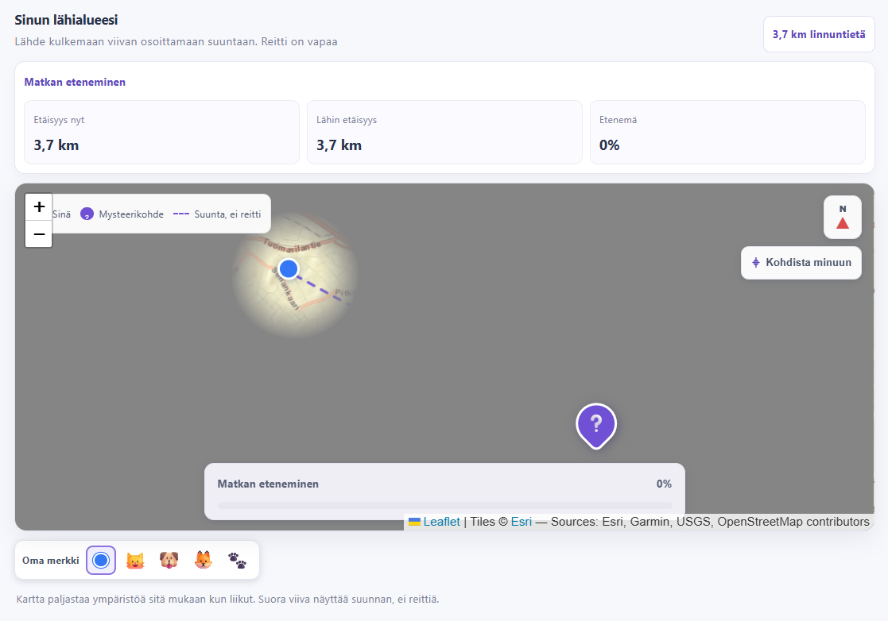

# Sivupolku
### Kuinka hyvin todella tunnet lähialueesi tiet ja polut 🗺️?
> Palautus Softamestari 2026 esikarsinnan tehtävään (sarja: junnnusarja)


## Sovelluksen idea
Pelaaja valitsee haluamansa kategorian, josta etsitään kohde pelaajan valitsemalla etäisyydellä. Pelaaja ei näe kohteen tarkkaa sijaintia, joten pelaajan täytyy itse etsiä reitti ilman navigaattorin apua. Pelatessa pääsee testaamaan, kuinka hyvin todella tuntee lähialueensa kulkureitit ja pääsee tutustumaan lähialueen kulttuuri- ja taidekohteisiin.

Sovelluksen tarkoituksena on innostaa ihmisiä liikkumaan lähiympäristössään ja lisätä tietoa lähialueen kulttuuri- ja taidekohteista. Pelaajan ei kannata odottaa voivansa kävellä suoraan kohteeseen, vaan hän joutuu itse miettimään miten pääseen kartan osoittamaan suuntaan.

Sovellus skaalautuu puhelimen näytölle, mikä tekee sen käytöstä käytännöllisempää.
## Demokuva



## Ominaisuudet
- Käyttäjä voi valita itselleen mieluisan kategorian, josta mysteerikohde etsitään.
- Kohteen maksimietäisyys voidaan valita
- Reitin etenemisen näyttäminen

## Sovelluksen käynnistäminen 
Vaatimukset: Node.js, npm
Suorita seuraavat komennot projektin juuressa

```bash
npm install
```
Käynnistä sovellus development-tilassa
```bash
npm run dev
```
Sovellus avautuu paikalliseen osoitteeseen

## Sovelluksen toiminta

Kohteet haetaan OpenStreetMapin Overpass APIsta. Sovellus kokeilee tarvittaessa
useampaa julkista Overpass-palvelinta, mutta palvelinten ruuhka tai
verkkoyhteysongelma voi aiheuttaa kohteen haussa ongelmia.

Seikkailun kohde ja viimeisin sijainti tallennetaan paikalliseen tallennustilaan,
jotta niitä ei menetetä sivua päivittäessä.
Pelaaja voi luovuttaa seikkailun paljastaakseen koko kartan ja kohteen tiedot,
minkä jälkeen hän voi aloittaa uuden seikkailun.

### Käytetyt teknologiat

- React
- JavaScript
- Leaflet / React-Leaflet
- OpenStreetMap
- Overpass API
- Browser Geolocation API
- Lisäksi paint.net logon piirtämiseen
